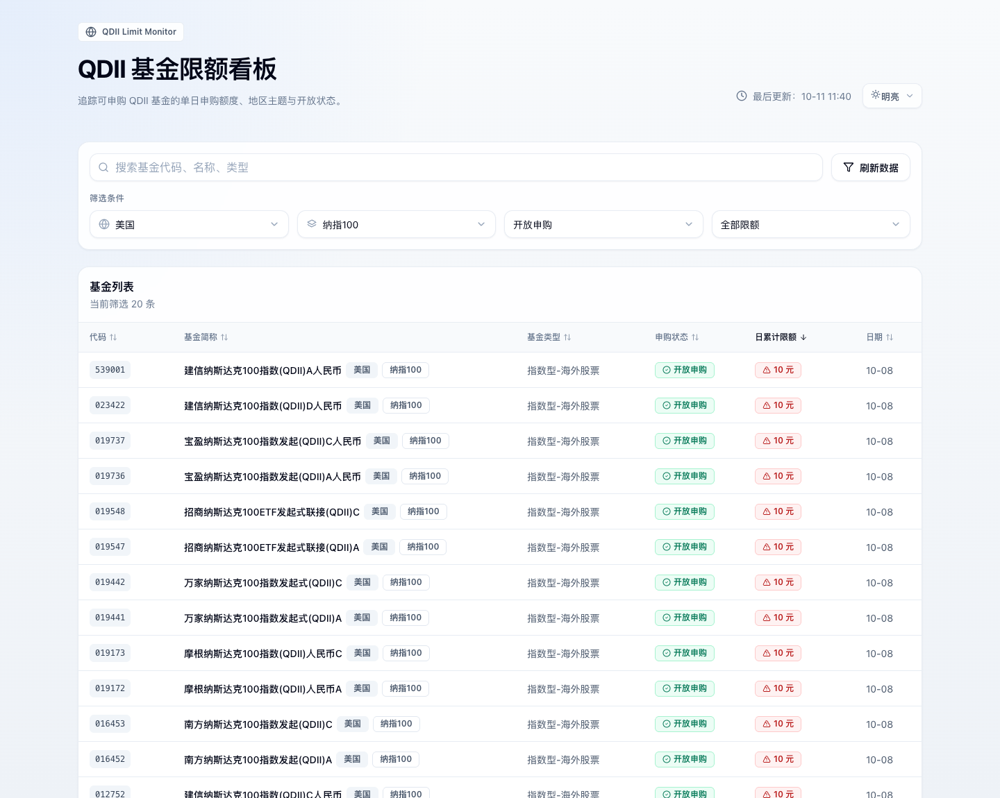
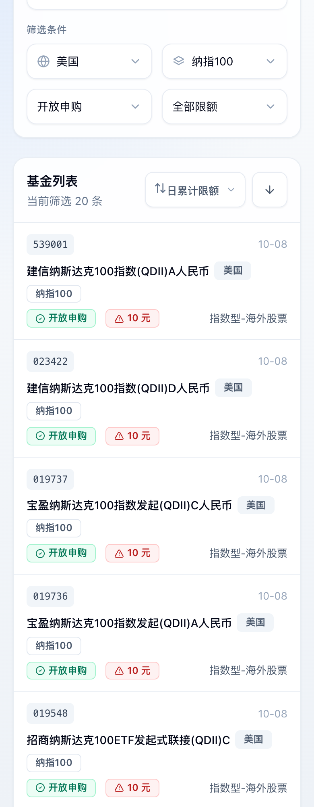
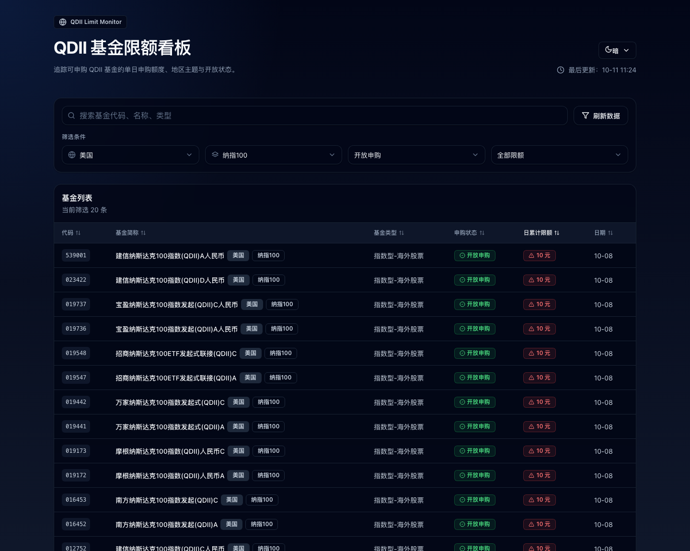
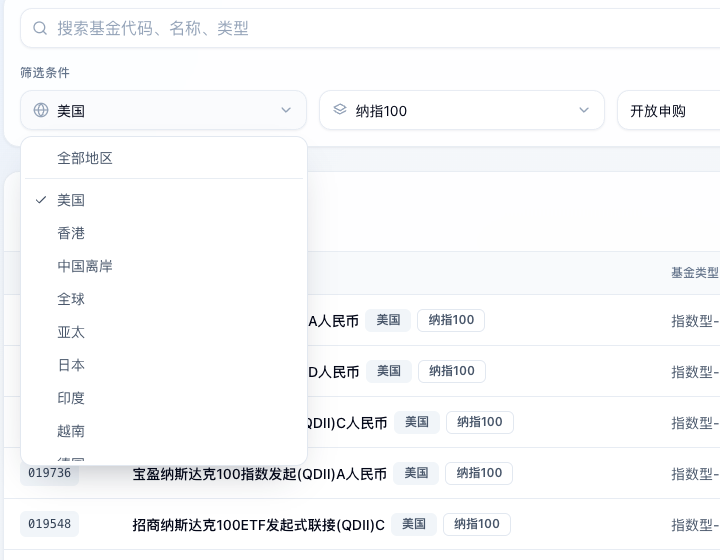

# QDII Limit Monitor（仿写版）

仿写自 [qdii-limit.vercel.app](https://qdii-limit.vercel.app/)（原始作者 [jomonylw/qdii-limit](https://github.com/jomonylw/qdii-limit)）的 QDII 基金申购限额看板：服务端拉取东方财富公开接口，在服务端完成 QDII 判定与地区 / 主题归纳，前端提供搜索、多选联动筛选、排序分页与明暗主题。



## 功能

- 查看 QDII / 海外基金的申购状态与日累计申购限额（统一为「开放申购 / 暂停申购」两种口径）
- 默认视图：美国 + 纳指 100 + 开放申购
- 按基金代码、基金简称、基金类型搜索
- 国家 / 地区多选（12 类）与主题多选（13 类），主题随地区联动：
  - 选择地区后，主题菜单只列出该地区实际存在的主题
  - 已选主题在新地区不存在时自动剔除，全部不可用时回落为「全部主题」
- 申购状态筛选（开放申购 / 暂停申购）与限额等级筛选（低 / 中 / 高 / 无限额）
- 表头点击排序（默认按日累计限额降序，暂停申购视为 -1 排在最后）
- 每页 50 条分页，显示「第 x / y 页 · 共 N 条」
- 点击基金代码或基金简称直达东方财富基金详情页
- 明暗主题切换（明亮 / 暗色 / 跟随系统，记忆在 localStorage）
- 「刷新数据」强制回源，跳过服务端 6 小时缓存
- 页脚注明数据来源与免责声明
- 手机与平板适配：手机卡片式列表、平板折叠次要列、44px 触屏点按目标

## 移动端与平板适配



- **手机（< 768px）**：表格改为卡片式行——第一行是基金代码与日期，第二行是名称与地区/主题徽章，第三行是申购状态、日累计限额与基金类型。状态和限额不再需要横向滚动就能看到；表头隐藏后，排序改用列表头右侧的「排序字段 + 升降序」控件（桌面端隐藏该控件，直接点表头排序）。
- **平板竖屏（768–1099px）**：折叠「基金类型」列，代码 / 名称 / 申购状态 / 日累计限额 / 日期全部一屏可见，且保留可点击排序的表头。折叠用的是「零宽 + 裁剪」而不是 `display:none`——固定列宽表格里隐藏单元格会让后续单元格整体左移一列造成错位。
- **触屏设备**：按钮、下拉、搜索框的点按目标统一放大到 44px 以上，并去掉只在悬停时成立的反馈；过滤条件下拉菜单加大行高。
- **其它**：过滤条件在手机上排成两列以节省纵向空间；支持刘海屏安全区（`env(safe-area-inset-*)`）；`theme-color` 让移动浏览器地址栏跟随明暗；禁用 iOS 横屏自动放大字号（`text-size-adjust`）。
- 各档宽度都做过程序化校验：手机（iPhone SE / 13 / 15 Pro Max / Pixel 5）、平板（iPad Mini / iPad Pro 11 竖屏与横屏）、桌面（820–1920px）下页面与单元格零溢出。



## 运行

零依赖（Node 18+ 自带 `fetch`），无需 `npm install`：

```bash
node server.js              # 默认 http://127.0.0.1:3000
PORT=8080 node server.js    # 自定义端口
HOST=0.0.0.0 node server.js # 允许局域网访问
```

浏览器打开 http://127.0.0.1:3000 即可；`?theme=dark` / `?theme=light` 可指定初始主题。

静态托管模式（没有服务端时）：先生成一次数据快照，再用任意静态服务器托管 `public/`：

```bash
npm run build:static                              # 抓取数据写入 public/data/funds.json
python3 -m http.server 8100 --directory public     # 任意静态服务器均可
```

前端会先尝试请求 `/api/funds`，接口不可用时自动回退读取 `data/funds.json` 快照。

## 接口与缓存

| 请求 | 说明 |
| --- | --- |
| `GET /api/funds` | 命中 6 小时内存缓存 |
| `GET /api/funds?refresh=1` | 强制回源（「刷新数据」按钮使用） |
| `GET /api/funds?sort=fcode,desc` | 透传上游排序参数，默认 `fcode,asc` |

响应头：

```text
Cache-Control: public, s-maxage=21600, stale-while-revalidate=43200
X-Cache-State: HIT | MISS | STALE | REFRESHED
```

缓存策略与原站一致：数据 6 小时内视为新鲜；过期后 12 小时内先返回旧数据并在后台刷新（stale-while-revalidate）；回源失败且存在旧数据时兜底返回旧数据，无旧数据则返回 502。

## 部署到 GitHub Pages

线上站点：<https://yangdinghui.github.io/qdii-limit/>

仓库内置工作流 `.github/workflows/pages.yml`：

- 推送到 `main`：检出代码 → `node scripts/build-static.js` 重新抓取上游数据 → 上传 `public/` → 部署到 Pages
- 每 2 小时定时重建一次（cron `17 */2 * * *`），线上数据自动保持新鲜
- 也可在仓库 Actions 页手动触发（`workflow_dispatch`）

线上是「静态站点 + 构建时数据快照」：没有服务端进程，数据新鲜度由构建频率决定（默认 2 小时），页面上的「最后更新」即构建时的抓取时间。

数据兜底：构建时若上游抓取失败（网络受限等），脚本会保留仓库中已有的 `public/data/funds.json` 继续部署，站点不会因此构建失败，只会停留在上一份数据。

Pages 配置：仓库 Settings → Pages → Source 选择「GitHub Actions」（等价于 `PUT /repos/{owner}/{repo}/pages`，`build_type: workflow`）。

后续更新：

```bash
git add -A && git commit -m "..." && git push   # 推送后自动触发一次部署
```

要换绑自有域名：在 Settings → Pages 里填 Custom domain，并在域名侧加 CNAME 记录指向 `yangdinghui.github.io`。

## 数据口径

- 数据源：`https://fund.eastmoney.com/Data/Fund_JJJZ_Data.aspx`（`t=8`，全量约 2.7 万只基金、4MB 左右，本机实测 2–3 秒），在服务端一次性拉齐后本地筛选。
- QDII / 海外入选：基金类型含 `QDII` 或 `海外`，或基金简称含 `QDII`（当前约 738 只）。
- 状态归一化：原始状态含「暂停」、日累计限额为 0、或限额小于起购金额 → 暂停申购；其余 → 开放申购。
- 限额等级：≤ 1000 元低限额、≤ 10000 元中限额、< 1 亿元高限额、≥ 1 亿元无限额。
- 地区 / 主题：按基金简称与类型中的关键词归纳，规则与原站一致（首个命中的规则生效）。

## 项目结构

```text
qdii-limit/
  server.js                  Node HTTP 服务：静态资源 + /api/funds + 内存缓存
  lib/
    eastmoney.js             上游请求、解析（vm 沙箱求值 JS 对象字面量）、字段标准化
    fund-rules.js            QDII/地区/主题/交易形态/限额等级/格式化规则
  public/
    index.html               页面骨架
    styles.css               设计令牌与组件样式（浅色 / 深色）
    app.js                   前端状态、筛选联动、排序分页、主题、通知
    icon.svg                 favicon
    data/funds.json          静态托管用的数据快照（构建产物，随仓库提交）
  scripts/
    self-test.js             逻辑自测（对真实上游数据，26 项）
    build-static.js          生成静态数据快照
  .github/workflows/
    pages.yml                抓取数据 → 构建 → 部署 GitHub Pages（含 2 小时定时）
  docs/                      截图
```

## 自测

```bash
node scripts/self-test.js
```

覆盖 26 项：响应结构、状态与限额口径一致性、筛选结果与独立实现交叉验证、地区↔主题联动、排序单调性、分页、多选摘要、HTML 转义与时间格式化。当前结果 26/26 通过。

另有一套 34 项的浏览器交互测试（puppeteer-core 驱动本机 Chrome，覆盖下拉多选、联动剔除、单选关闭、排序、翻页、搜索、主题切换与运行时错误监控），脚本放在独立目录运行，不污染本项目的零依赖。需要时可另行提供。



## 与原站的关系与差异

- 功能、交互、视觉按原站仿写；原站技术栈为 Next.js App Router + Tailwind CSS + shadcn/ui + TanStack Table，本项目用零依赖 Node + 原生 HTML / CSS / JS 重写，代码为独立实现。
- 数据口径保持一致：QDII 入选规则、地区 / 主题关键词、限额等级阈值、状态归一化、默认筛选与默认排序均对齐原站。
- 部署方式不同：原站是 Vercel 上的 Next.js 服务端应用（Route Handler + CDN 缓存），本项目同时支持本地 Node 服务模式与 GitHub Pages 静态模式——静态模式用「构建时快照 + 每 2 小时定时重建」替代实时服务端缓存。
- 未复刻：Google Analytics、JSON-LD / robots / sitemap 等 SEO 文件。
- 上游仓库未声明开源许可证，本项目仅作学习与自用仿写；如有侵权请联系删除。

## 免责声明

本站数据来自公开网络接口，经过系统自动分类整理，仅供研究参考，不构成任何投资建议。上游字段与接口行为可能变化，若出现异常需要同步调整解析逻辑。
